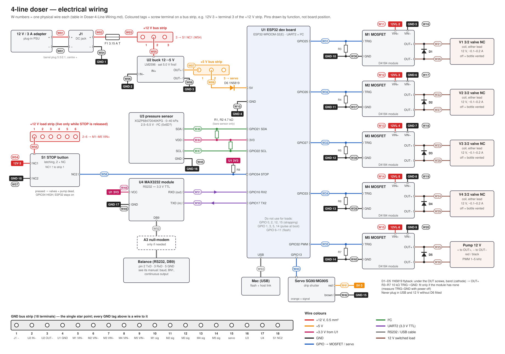
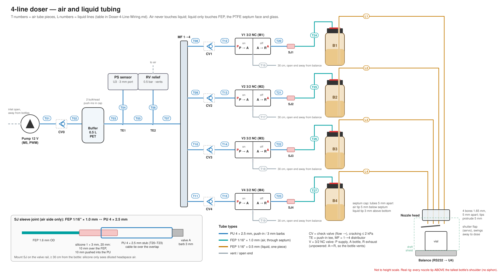

# 4-line doser — wiring and tubing

Every wire (W01–W57) and every tube (T01–T27, L1–L4) of the 4-line test rig from the
[parts list](Doser-4-Line-BOM.md), with what it connects, what it is made of, and how to test it.
Both diagrams are generated by `doser-wiring/make_wiring_svg.py`; edit the script, not the SVGs.

---

## ESP32 pin map

| ESP32 pin | Net | Goes to | Wire |
|---|---|---|---|
| 5V | +5 V in | D6 cathode (D6 anode ← +5 V strip 2) | W09 |
| GND | GND | GND strip 4 | W10 |
| 3V3 | +3.3 V out | U3 VDD, U4 VCC | W44, W48 |
| GPIO21 | I²C SDA | U3 SDA (+ R1 4.7 kΩ to 3V3) | W46 |
| GPIO22 | I²C SCL | U3 SCL (+ R2 4.7 kΩ to 3V3) | W47 |
| GPIO16 | UART2 RX | U4 RXD (data from the balance) | W51 |
| GPIO17 | UART2 TX | U4 TXD (commands to the balance) | W50 |
| GPIO25 | valve 1 | M1 TRIG | W31 |
| GPIO26 | valve 2 | M2 TRIG | W32 |
| GPIO27 | valve 3 | M3 TRIG | W33 |
| GPIO33 | valve 4 | M4 TRIG | W34 |
| GPIO32 | pump, PWM (LEDC 1–5 kHz) | M5 TRIG | W35 |
| GPIO13 | servo, 50 Hz | servo signal (orange) | W43 |
| GPIO34 | stop button, input only | S1 NC2 (+ R8 10 kΩ to 3V3; HIGH = stopped) | W56 |
| micro-USB | USB | Mac (flashing, host link) | W53 |

**Pins kept free:**
- GPIO 0, 2, 12 and 15 are strapping pins.
- GPIO 1, 3, 5 and 14 pulse at boot and would click a valve.
- GPIO 6–11 belong to the flash chip.

**Board choice:** use a WROOM-32 board, as listed. On a WROVER board, GPIO 16/17 are taken by the PSRAM; move UART2 to GPIO 4 (RX) and GPIO 18 (TX).

## Electrical connections

**Wire types:**
- 0.5 mm² stranded wire for all 12 V and 5 V power wires.
- Dupont jumpers for signals.
- Twist each TRIG wire with its GND wire.

**Bus strips** (screw terminals or a perfboard strip):
- **+12 V strip:** 3 terminals, always live: fuse in, buck, stop button.
- **+12 V load strip:** 6 terminals, live only while STOP is released. It feeds M1–M5.
- **+5 V strip:** 3 terminals.
- **GND strip:** 18 terminals. This is the only point where grounds meet (star point).

### Power

| Wire | From | To | Type | Note |
|---|---|---|---|---|
| W01 | 12 V adapter | J1 DC jack | adapter cable, barrel 5.5/2.1, centre + | check the polarity with a meter |
| W02 | J1 + | F1 fuse holder | red 0.5 mm² | 3.15 A slow-blow |
| W03 | F1 | +12 V strip 1 | red 0.5 mm² | |
| W04 | J1 − | GND strip 1 | black 0.5 mm² | |
| W05 | +12 V strip 2 | U2 buck IN+ | red 0.5 mm² | |
| W06 | U2 IN− | GND strip 2 | black 0.5 mm² | |
| W07 | U2 OUT+ | +5 V strip 1 | orange 0.5 mm² | **set U2 to 5.0 V with a meter before connecting anything** |
| W08 | U2 OUT− | GND strip 3 | black 0.5 mm² | |
| W09 | +5 V strip 2 | D6 anode → D6 cathode → U1 5V | orange | D6 1N5819, band towards the ESP32 |
| W10 | U1 GND | GND strip 4 | black Dupont | |

**Why D6:** the ESP32 dev board must not be fed from both USB and its 5V pin. D6 blocks the buck from pushing current into USB, so the Mac can stay plugged in while the 12 V supply is on. The ESP32 then sees about 4.6 V, which its regulator handles.

### Valves and pump (M1–M4 = valves V1–V4, M5 = pump)

| Wire | From | To | Type |
|---|---|---|---|
| W11–W15 | +12 V load strip 2–6 | M1–M5 VIN+ | red 0.5 mm² |
| W16–W20 | M1–M5 VIN− | GND strip 5–9 | black 0.5 mm² |
| W21–W25 | M1–M5 OUT+ | V1–V4 coil lead / pump red | valve lead, extended with red 0.5 mm² if needed |
| W26–W30 | M1–M5 OUT− | V1–V4 other coil lead / pump black | as above |
| W31–W35 | U1 GPIO 25 / 26 / 27 / 33 / 32 | M1–M5 TRIG | blue Dupont |
| W36–W40 | M1–M5 signal GND | GND strip 10–14 | black Dupont, twisted with its TRIG wire |

**Parts at the modules:**
- **D1–D5 (1N5819):** one across each load, clamped under the OUT+ and OUT− screws. Band (cathode) to OUT+. Without them the coils' switch-off spikes kill the MOSFETs.
- **R3–R7 (10 kΩ):** TRIG to GND, so a floating pin during boot cannot open a valve. First measure TRIG to GND with the power off. If you read about 10 kΩ, the module already has one; fit R3–R7 only if it doesn't.
- **Polarity:** the valve coils have none; the pump does (red to OUT+).

### Stop button S1 (latching mushroom, 2 NC contacts)

| Wire | From | To | Type | Note |
|---|---|---|---|---|
| W54 | +12 V strip 3 | S1 NC1 terminal a | red 0.5 mm² | |
| W55 | S1 NC1 terminal b | +12 V load strip 1 | red 0.5 mm² | |
| W56 | S1 NC2 terminal a | U1 GPIO34 | Dupont | R8 10 kΩ from GPIO34 to 3V3 at the ESP32 (GPIO34 has no internal pull-up) |
| W57 | S1 NC2 terminal b | GND strip 18 | Dupont | |

**What a press does:**
- NC1 opens and cuts the 12 V to all valves and the pump. The valves fall back to venting.
- The ESP32, sensor, servo and balance link stay powered.
- NC2 opens, so GPIO34 reads HIGH. A broken wire also reads HIGH, so it fails safe.
- The firmware only reports the stop; it cannot override it (feasibility note §2a).

### Servo, sensor, balance, USB

| Wire | From | To | Type | Note |
|---|---|---|---|---|
| W41 | +5 V strip 3 | servo red | servo cable | servo current never flows through the ESP32 |
| W42 | servo brown | GND strip 15 | servo cable | |
| W43 | U1 GPIO13 | servo orange | servo cable | |
| W44 | U1 3V3 | U3 VDD | Dupont | sensor runs on 2.5–5.5 V |
| W45 | U3 GND | GND strip 16 | Dupont | |
| W46 | U1 GPIO21 | U3 SDA | Dupont | R1 4.7 kΩ SDA→3V3, bare sensor only |
| W47 | U1 GPIO22 | U3 SCL | Dupont | R2 4.7 kΩ SCL→3V3, bare sensor only |
| W48 | U1 3V3 | U4 VCC | Dupont | the MAX3232 must run on 3.3 V, not 5 V |
| W49 | U4 GND | GND strip 17 | Dupont | |
| W50 | U1 GPIO17 (TX2) | U4 TXD | Dupont | the TTL pin the module *receives* on |
| W51 | U4 RXD | U1 GPIO16 (RX2) | Dupont | the TTL pin the module *sends* on |
| W52 | U4 DB9 | balance DB9 (via the A3 null-modem only if needed) | RS232 cable, pins 2, 3, 5 | 3.3 V UART pins must never touch the RS232 side (±6–12 V) |
| W53 | U1 micro-USB | Mac | USB data cable | |

**Sensor details:**
- Take the XGZP6847D pin numbers from its datasheet; the drawing names the pins by function only.
- An I²C scan shows its address (CFSensor parts usually answer at 0x6D).
- The MPRLS breakout (lab-grade version) answers at 0x18 and has its own pull-ups, so R1/R2 are not needed with it.

**RX/TX labels:** module makers label the TTL side differently. If the balance sends but nothing arrives, swap W50/W51 first; only then try the null-modem.

---

## Air and liquid connections

**Tube types:**
- **Air side:** PU 4 × 2.5 mm. It plugs into the push-in fittings and slides over the 3 mm barbs.
- **Through the septum:** FEP 1/16" tubes only.
- **Liquid path:** each line is one unbroken FEP tube from the bottle bottom to the nozzle tip, with no joints.

### Air supply (shared)

| Tube | From | To | Type, length | Note |
|---|---|---|---|---|
| — | air | pump inlet | open | inlet away from the bottles, so it never draws fragrance vapour |
| T01 | pump outlet | CV0 in | PU, ~10 cm | CV0 arrow pointing away from the pump |
| T02 | CV0 out | buffer bulkhead IN | PU, ~10 cm | |
| T03 | buffer bulkhead OUT | TE1 | PU, ~10 cm | |
| T04 | TE1 branch | pressure sensor port (U3) | PU, ≤ 10 cm, over the 3 mm port | |
| T05 | TE1 | TE2 | PU, ~5 cm | |
| T06 | TE2 branch | relief valve RV | PU, ~5 cm | RV outlet open to air, set to its 0.5 bar minimum |
| T07 | TE2 | manifold MF inlet | PU, ~10 cm | |

### Per line (n = 1–4)

| Tube | From | To | Type, length | Note |
|---|---|---|---|---|
| T08–T11 | MF outlet n | CVn in | PU, ~10 cm | CV arrow pointing towards the valve |
| T12–T15 | CVn out | Vn port P | PU, ~10 cm | |
| T16–T19 | Vn port R | open end | PU, 30 cm | diffusion barrier. Point the open end away from the balance: the vent puff at valve switch-off would otherwise disturb the reading |
| T20–T23 | Vn port A | SJn sleeve joint | PU, ~3 cm stub | |
| T24–T27 | SJn | septum cap of bottle n | FEP 1/16" × 1.0 mm, ~0.5 m | tip 5 mm below the septum |
| L1–L4 | 3 mm above the bottom of bottle n | nozzle head bore n | FEP 1/16" × 0.5 mm, ~0.8 m, one piece | tip protrudes 5 mm, pointing down; slot labels on both ends |

**Finding P, A and R on a valve:** the barbs are often unmarked. With the valve unpowered, blow into each barb in turn: the two barbs that pass air are A and R. The barb that stays blocked is P. Power the valve: P now passes to A.

**Sleeve joint SJ:** the 1.6 mm FEP air tube cannot go straight onto a 3 mm barb.
1. Cut 20 mm of silicone tube 1 × 3 mm.
2. Push 10 mm of it over the FEP.
3. Push the other 10 mm into the PU stub. The PU squeezes the silicone onto the FEP.
4. Put a cable tie over the overlap.

It holds far more than 20 kPa. Mount it on the valve rail, at least 30 cm from the bottle, so the silicone only meets diluted headspace air. This joint is the only silicone anywhere near the fragrance, and it is on the air side.

---

## Bring-up order

Test each stage before connecting the next:

1. **12 V and buck, nothing else connected:**
   1. Check the J1 polarity.
   2. Set U2 to 5.0 V.
   3. Check that every strip terminal reads the right voltage.
2. **ESP32 on USB only:** run an I²C scan. U3 must answer.
3. **Stop button, 12 V still off:** GPIO34 reads LOW when released and HIGH when pressed.
4. **Balance:**
   1. Loop-back test: bridge DB9 pins 2–3 on U4 and send from GPIO17. The bytes must come back on GPIO16.
   2. Remove the bridge, connect the balance and read the weight.
5. **12 V to the ESP32 through D6, with USB still plugged in:** the board must not reset. Measure about 4.6 V at the 5V pin.
6. **Loads, one at a time:** switch each valve from the serial console and listen for the click. Then run the pump at 30 % PWM. Watch for any reset when the pump starts. Press STOP while a valve is open: it must drop out at once.
7. **Air side, valve outputs (A ports) plugged:**
   1. Pump to 20 kPa.
   2. Stop the pump.
   3. Log the pressure decay: under 0.2 kPa/min.
   4. Unpower each valve: its line must vent through R.
8. **Septum caps fitted:** seal check per bottle, as in the [feasibility note §3](Perfume-Doser-Feasibility.md).
9. **Liquid lines last:** check the nozzle heights against the tallest bottle, then do the first dry-run doses into the vial.

## Parts this adds to the list

Both are now in the [parts list](Doser-4-Line-BOM.md) and [xlsx](Doser-4-Line-BOM.xlsx):
- **B10:** silicone tube 1 × 3 mm for SJ1–SJ4. eBay listing; the price is an estimate.
- **E4b:** 2 × 4.7 kΩ pull-ups from BerryBase.

- **D6:** uses the sixth 1N5819 that was already listed.
- **R8:** the stop button's pull-up; the 10 kΩ count goes from 5 to 6.

The totals, including the stop button from the Wi-Fi/stop-button branch, are ≈ EUR 342 (budget) and ≈ EUR 702 (lab-grade).

Valve 4 moved from GPIO 14 to GPIO 33, because GPIO 14 pulses at boot.
