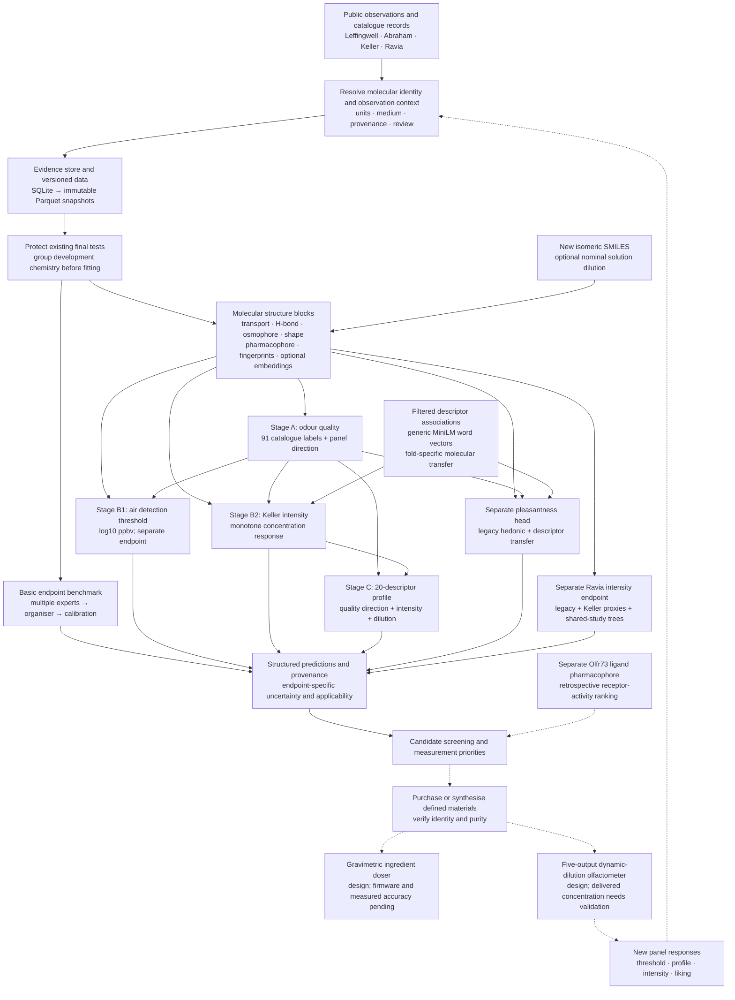
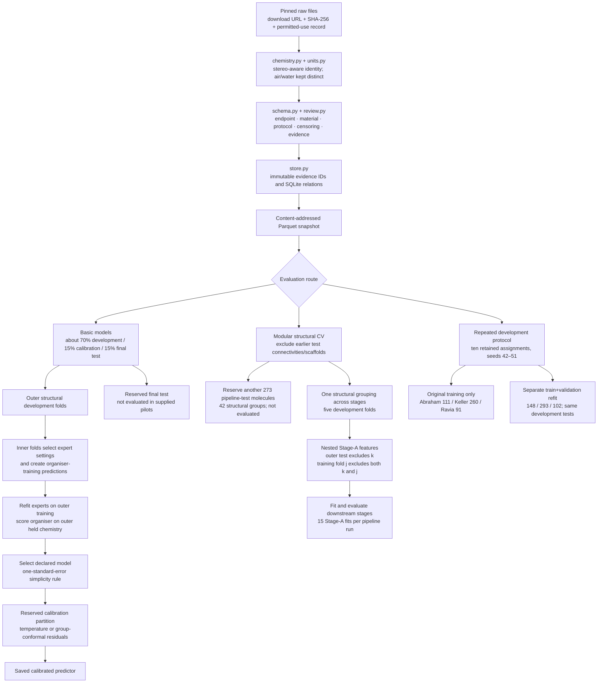
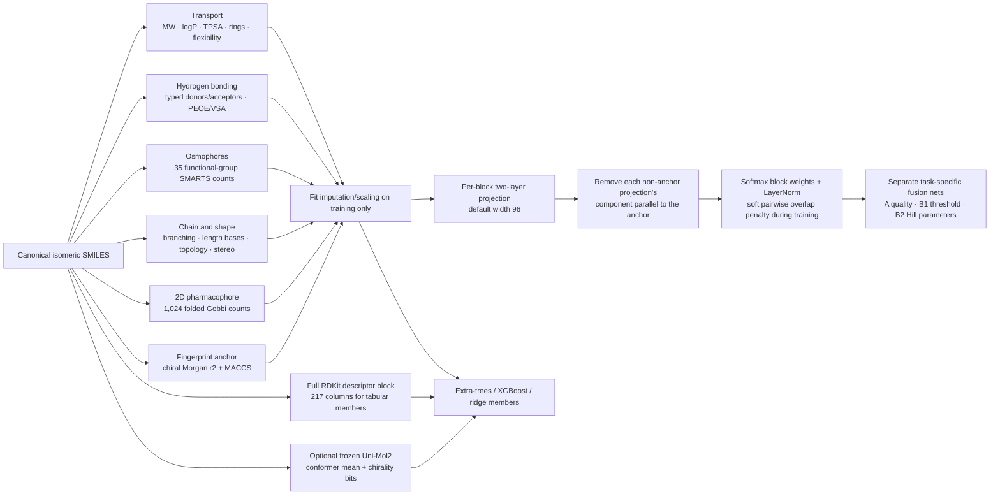
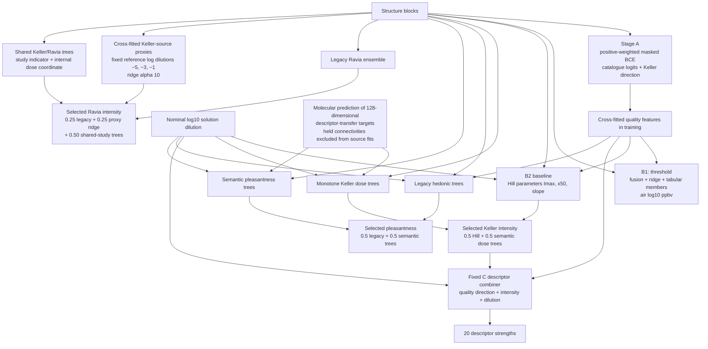
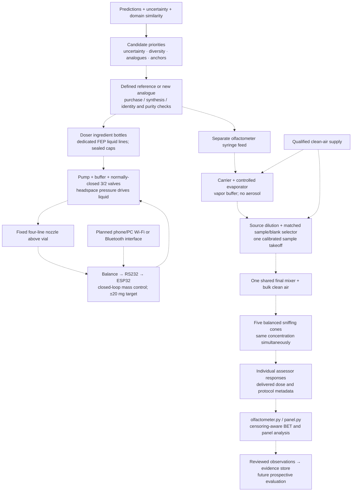
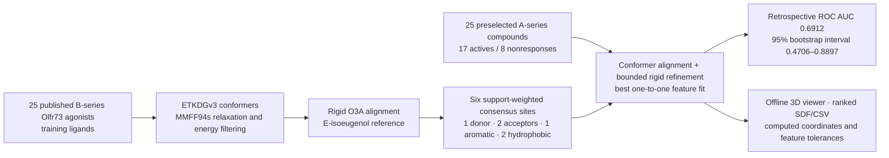

# CALNEW: project architecture and model performance

CALNEW connects molecular odour prediction, candidate selection and proposed laboratory measurement. The working software has two model routes: an endpoint-specific benchmark system and a modular quality → intensity → descriptor-profile pipeline. A separate mouse-receptor pharmacophore calculation and two hardware designs extend the research, but are not validated parts of one integrated prediction-to-laboratory system.

**Read the editable map:** [[CALNEW Detailed Project Map.canvas]]. This report supplies the detailed diagrams, score tables and source links behind that map. A [scalable overview diagram](reports/project-map-2026-10-26/project-flowchart.svg) is also available. The companion [evidence manifest](reports/project-map-2026-10-26/evidence.json) retains exact values and hashes of the inspected files.

Compiled from saved local code, manifests and results. No models were retrained, no new inference was run and no reserved final-test targets were opened for this report. “Current” below means the latest verified result found in these saved artifacts, not a new evaluation on 26 October.

## 1. Whole-project flow

Solid arrows show implemented data/model paths. Dashed arrows show proposed integration or future experimental work. Hardware nodes describe designs; their arrows do not establish that a rig has been built or calibrated.

The threshold branch does **not** currently determine a measured gas concentration for the intensity branch. Keller's model uses nominal solution dilution in paraffin oil. The Ravia head has one highest-presentation endpoint and accepts no arbitrary-dose input. Formula generation and automatic formula-to-doser execution are future work.

Sources: [software scope](docs/ARCHITECTURE.md), [pipeline](docs/PIPELINE.md), [current serving code](src/calnew/pipeline/run.py), [doser status](Auto%20doser/OVERVIEW.md).

## 2. Evidence, datasets and evaluation boundaries

| Dataset or source | Stored/eligible size | What its targets mean | Where it is used |
|---|---:|---|---|
| Leffingwell, initial snapshot | 3,522 molecules; 113 original columns | Catalogue descriptor associations; an unreported label is not a measured human nonresponse | Basic descriptor task: 90 scored labels |
| Abraham 2012, initial snapshot | 268 rows; 57 marked as upstream aggregates | Airborne detection threshold, transformed to log10 ppbv | Basic threshold task |
| Leffingwell, modular run | 2,589 molecules × 91 labels | Filtered catalogue labels after protected exclusions | Stage A |
| Abraham, modular/development work | 186 eligible molecules/observations | Air threshold; lower is more potent | Stage B1 and repeated development benchmark |
| Keller, modular run | 326 molecules; 658 stimuli | Mean panel ratings at observed nominal solution dilutions | Intensity, descriptor profile and pleasantness |
| Ravia, development work | 114 eligible molecules | Published group mean at each molecule's most concentrated presentation | Separate intensity head |
| Li 2025 auxiliary water thresholds | 716 numeric rows; 567 after initial reserved exclusions | Water thresholds, explicitly flagged as auxiliary source rows | Training-only threshold auxiliaries; further exclusions occur inside each fit |
| Filtered augmented descriptor corpus | 7,000 molecules; 1,098,957 unique associations | Research descriptor associations, not measured sensory responses | Molecular-to-semantic transfer features |

The initial snapshot has **3,622 distinct molecular identities and 398,254 observations** across Leffingwell and Abraham. Observation count is not independent molecule count. Keller/Ravia and auxiliary sources belong to later routes; they are not all part of that original snapshot.

Structural groups use ring scaffolds and fingerprint clustering for acyclic molecules. The modular run excludes **709 molecules** for earlier final-test protection. Its protected tests and the repeated development test subsets are different objects: the latter have already been used for research comparisons and are not untouched final tests.

**Known development overlap:** the saved audit identifies Abraham training/test connectivity overlap in seeds **42, 44, 46, 50 and 51**, and Ravia overlap in seed **48**. The original assignments were retained for paired comparisons. These ten-split scores therefore do not establish fully connectivity-disjoint generalisation. Keller has no such overlap in that audit. Auxiliary source fits apply held-connectivity exclusions separately.

Sources: [data and lineage](docs/DATA.md), [modular manifest](runs/modular-pipeline-fingerprint-v5/run.json), [saved overlap/metric audit](runs/nose-parity-current-audit-20261002.json).

## 3. What the models are built from

### Basic benchmark: independent experts and an organiser

| Expert family | Representation and learner | Saved execution status |
|---|---|---|
| Physical/topological descriptors | RDKit descriptors → regularised linear/logistic head | Both basic tasks |
| Fingerprints | Chiral Morgan → random forest / XGBoost; linear and neighbour controls available | Both basic tasks |
| Similarity kernel | Tanimoto Gaussian process | Threshold task |
| Native graph | CALNEW directed bond-message network; stereo features; mean pooling | Both basic tasks |
| Chemprop | Published Chemprop 2.3.1 D-MPNN adapter | Threshold task |
| Frozen language representation | MoLFormer pooled embedding → fitted head | Threshold task |
| Frozen 3D representation | Uni-Mol2 84M; mean over up to 16 optimised conformers; appended chirality fingerprint | Threshold task |
| Organiser | Equal average, regularised stacking or small gating network | Compared with the individual experts |

This is a separate route from the explicit-block fusion below. The modular pipeline does not run every basic graph expert as one combined encoder. OpenPOM is an unavailable local adapter; learned receptor transfer, LoRA and full encoder fine-tuning are not completed model branches here.

### Modular pipeline: explicit blocks and fusion

Each task has its own trained fusion network; the diagram shows the common construction, not a single shared trained latent vector. Stage A uses six blocks including the 2D pharmacophore. The default potency nets use transport, H-bond, osmophore, chain, fingerprint and Stage-A quality features. Uni-Mol2 can be an alternative anchor and is also used by selected tabular members. Block weights are recorded in [gates.json](runs/modular-pipeline-fingerprint-v5/gates.json); they are learned weights, not causal biological importance.

Sources: [blocks.py](src/calnew/pipeline/blocks.py), [fusion.py](src/calnew/pipeline/fusion.py), [stages.py](src/calnew/pipeline/stages.py).

## 4. Current heads, inference and what is optional

The Hill branch models `I = Imax / (1 + exp(−slope × (x − x50)))`, with positive slope. The selected Keller blend preserves nondecreasing predicted intensity. In C, a learned magnitude depending on intensity/dilution multiplies a quality direction, with a regularised residual; training uses measured intensity and evaluation also checks predicted intensity. Pleasantness now has a separate head instead of relying on C's older pleasantness output.

**Serving choices matter.** `pipeline predict --run runs/modular-pipeline-fingerprint-v5` serves the saved baseline heads. Adding `--intensity-run runs/nose-intensity-keller-refit-v3` substitutes the selected Keller blend **before** computing C. Adding `--semantic-run runs/nose-semantic-pleasantness-v3` selects the improved pleasantness bundle. The newer heads are not silently enabled by the baseline run. Ravia uses `pipeline intensity-predict --dataset ravia` with its separate recommended artifact, `runs/nose-intensity-ravia-joint-refit-v2`.

The Ravia reference doses are latent Keller-source features, not measured Ravia concentrations. Final serving bundles can be fitted on the full eligible development cohort; their training size must not be confused with the smaller held-development evaluation fits.

Sources: [inference integration](src/calnew/pipeline/run.py), [semantic transfer](src/calnew/pipeline/semantic.py), [Keller intensity](src/calnew/pipeline/intensity.py), [Ravia proxies](src/calnew/pipeline/dose_transfer.py), [shared-study head](src/calnew/pipeline/joint_intensity.py), [selected recipes](docs/INTENSITY-IMPROVEMENT.md).

## 5. Model performance, kept separate by protocol

`r` is Pearson correlation, not a percentage of correct predictions. AP is average precision; AUROC measures ranking discrimination. MAE/RMSE measure error in the stated target units. A higher correlation can coexist with worse absolute error.

### 5a. Initial basic models: nested structural development folds

Air threshold: **188 development / 40 calibration / 40 final-test rows**; three outer folds and two inner folds. Values below are mean outer-fold MAE ± standard error in **log10 ppbv**. The saved pilot uses one declared configuration and seed per candidate.

| Threshold candidate | MAE ± SE ↓ |
|---|---:|
| RDKit descriptors + regularised linear model | **0.9403 ± 0.0523** |
| Equal average | 0.9897 ± 0.0541 |
| Gating ensemble | 1.0195 ± 0.0852 |
| Morgan + XGBoost | 1.0526 ± 0.1328 |
| Frozen Uni-Mol2 + chirality + linear | 1.0651 ± 0.0726 |
| Regularised stacking | 1.0900 ± 0.0357 |
| Tanimoto GP | 1.1323 ± 0.0903 |
| Frozen MoLFormer + linear | 1.1466 ± 0.0737 |
| Morgan + random forest | 1.2133 ± 0.0844 |
| Chemprop D-MPNN | 1.2723 ± 0.0964 |
| Native CALNEW D-MPNN | 1.2993 ± 0.1093 |

Catalogue descriptors: **2,466 development / 528 calibration / 528 final-test molecules**, with **90 scored labels**. Values are mean outer-fold macro AP ± standard error.

| Descriptor candidate | Macro AP ± SE ↑ |
|---|---:|
| Equal average | **0.2548 ± 0.0184** |
| Gating ensemble | 0.2401 ± 0.0235 |
| Regularised stacking | 0.2277 ± 0.0177 |
| RDKit + logistic | 0.2275 ± 0.0215 |
| Morgan + random forest | 0.2180 ± 0.0163 |
| Morgan + XGBoost | 0.2118 ± 0.0168 |
| Native CALNEW D-MPNN | 0.1740 ± 0.0134 |

The selected descriptor average has **pooled OOF macro AP 0.2176**, distinct from the fold-mean 0.2548. Neither is interchangeable with the modular 91-label score. Basic-model calibration targets 90% regression coverage, but independent final coverage is unmeasured. The threshold MAE 0.9403 corresponds to a geometric absolute-error factor of roughly **8.7×**.

Source: [basic-model report and original run links](docs/BASIC-MODELS.md).

### 5b. Modular pipeline: five-fold structural development CV

Run: `modular-pipeline-fingerprint-v5`; **2,589 quality molecules, 186 air thresholds, 658 Keller stimuli / 326 molecules**. These are pooled out-of-fold development metrics, not scores on the 273 reserved pipeline-test molecules.

| Stage / model | Main result | Comparison or extra metric |
|---|---|---|
| A: quality fusion | Macro AP **0.2406**; AUROC **0.8278** | Logistic: AP 0.2318; AUROC 0.8056 |
| A: panel direction | Cosine **0.8396** | Mean-direction baseline 0.8346; high cosine alone is weak evidence |
| B2: Hill intensity | Pearson **0.6067**; RMSE **18.241** | Flat extra-trees: r 0.5823; RMSE **17.204**, so the Hill head does not win every metric |
| C: descriptor profile, measured intensity | Mean descriptor r **0.3247** | Oracle diagnostic; measured intensity is unavailable for a new molecule |
| C: descriptor profile, predicted intensity | Mean descriptor r **0.2655** | Loss of about 0.059 r from propagated intensity error |
| Flat extra-trees descriptor profile | Mean descriptor r **0.3254** | Strong direct baseline |
| Original C pleasantness, measured/predicted intensity | r **0.4913 / 0.3833** | Diagnostic of intensity-error propagation |
| Separate v2 hedonic head | r **0.4985** | Flat extra-trees pleasantness r 0.4811 |

| B1 threshold model | Pooled MAE ↓ | Spearman ↑ | Within 10× ↑ |
|---|---:|---:|---:|
| Fusion | **0.8257** | 0.6695 | **69.4%** |
| v2 members, served default ensemble | 0.8288 | **0.6903** | 67.2% |
| Fusion + explicit/quality ridge ensemble | 0.8375 | 0.6593 | 65.1% |
| Ridge: explicit + quality | 0.9041 | 0.6061 | 61.8% |
| Ridge: explicit only | 0.9339 | 0.5492 | 58.6% |
| Ridge: explicit + fingerprint | 0.9448 | 0.5577 | 60.8% |
| Ridge: fingerprint only | 1.0270 | 0.4530 | 58.1% |
| Training-mean baseline | 1.2141 | −0.1295 | 48.9% |

Threshold MAE is in log10 ppbv. Pooled MAE and fold-mean MAE differ; the fusion's fold-mean is 0.8095 ± 0.0700 SE. Small differences between the top recipes are below the fold variability. The fusion's nominal Gaussian 90% interval covers only **47.3%** of these held-development values. Pipeline serving instead uses an approximate OOF residual-quantile interval; that is distinct from the basic benchmark's independent calibration partition and is not a final coverage guarantee. The selected Keller blend reports uncertainty as unestimated.

Sources: [raw metrics](runs/modular-pipeline-fingerprint-v5/metrics.json), [manifest](runs/modular-pipeline-fingerprint-v5/run.json), [run report](runs/modular-pipeline-fingerprint-v5/REPORT.md).

### 5c. Latest selected heads: ten retained development assignments

Means across split seeds **42–51**. “Original” fits the original training partition only. “Refit” separately adds validation molecules while keeping the same development test targets. The known connectivity overlap described above applies. These rows must not be ranked against the structural-CV rows as if the evaluation were identical.

| Endpoint / selected recipe | Original train-only Pearson ↑ | Separate validation-refit Pearson ↑ | Original MAE ↓ | Evidence |
|---|---:|---:|---:|---|
| Abraham threshold, existing v2 | **0.785935** | 0.824471 | Not independently verified in the retained raw-prediction audit | Saved metric summaries |
| Keller pleasantness, legacy/semantic blend | **0.692984** | 0.708851 | 7.622 | IDs, targets and predictions audited |
| Keller intensity, Hill/semantic-dose blend | **0.626745** | 0.639398 | 10.519 | IDs, targets and predictions audited |
| Ravia intensity, shared-study blend | **0.597362** | 0.607009 | 11.748 | IDs, targets and predictions audited |
| Keller descriptors, selected intensity into fixed C | **0.426645** macro r | 0.427571 macro r | 2.516 | New paired fixed-C evaluation; all 20 cases independently verified |

For Keller intensity, the paired original baseline improves **0.569402 → 0.626745**, and MAE **11.676 → 10.519**. For the latest Ravia refinement, its already-improved predecessor improves **0.579667 → 0.597362**, and MAE **11.851 → 11.748**. Refit is a larger-training experiment, not proof that a changed architecture alone caused a gain.

The selected intensity/C combination improves descriptor macro r **0.419521 → 0.426645**, with lower MAE in all ten original splits. That direct paired experiment supersedes the older 0.420007 descriptor summary for this combination. It does not retrain or change the C recipe.

A separate larger-training **connectivity-grouped ten-fold threshold** experiment gives pooled r **0.842974**. It uses 166–168 training molecules and a different evaluation protocol; it does not replace the original-training threshold result.

The latest **threshold direction/confidence candidate** passed training-only selection: r **0.732907 → 0.744156** and MAE **0.737901 → 0.712893**, with positive correlation gains in three of three repeats. Its frozen ten-split benchmark remains pending in the inspected evidence. It is not yet a promoted serving result.

The local parity audit explicitly records that parity with the reference study is incomplete. Different cohorts, descriptor vocabulary, target processing and evaluation procedures prevent a shared-data reproduction claim. Split-to-split SD is not a confidence interval across independent trials.

Sources: [current numeric audit](runs/nose-parity-current-audit-20261002.json), [latest methods report](docs/NOSE-PARITY-AND-METHODS-REPORT.md), [paired descriptor results](runs/nose-descriptor-selected-intensity-audit-v3/results.json), [20-case verification](runs/nose-descriptor-selected-intensity-audit-v3/verification.json), [threshold candidate gate](runs/nose-threshold-disjoint-semantic-direction-inner-v1/gate-summary.json).

## 6. Experimental hardware and the feedback loop

The **doser** prepares ingredient mass. Its available work is feasibility, parts, wiring/tubing, septum analysis and Blender concepts. Firmware, wireless control implementation and measured dosing validation are pending. **±20 mg is an engineering target, not observed performance.**

The **olfactometer** delivers odour in air. The revised five-output design makes one final mixture and splits it to five cones, nominally about 22 L/min per outlet. Calibration, settling, recovery and delivered-concentration validation remain necessary project work. The notes describe DIN performance targets and explicitly do not claim demonstrated compliance. Existing software can process responses; it does not validate physical delivery.

There is no implemented automatic formula generator linking model output to the doser. The prospective synthesize/measure/retrain loop is a project direction rather than a completed experimental dataset.

Sources: [doser overview](Auto%20doser/OVERVIEW.md), [wiring](Auto%20doser/Doser-4-Line-Wiring.md), [five-output olfactometer design](Olfactometer-Five-Output-Design.md), [candidate-screening report](results/canvas-candidates-2026-09-24/REPORT.md), [measurement selection](src/calnew/active.py).

## 7. Separate receptor pharmacophore prototype

The run generates 378 conformers and retains 328 converged low-energy conformers. All top five candidates are published actives; eight of the top ten are active. Active-compound fit versus pEC50 is weak: Spearman **0.2279**, p **0.3789**. This is geometric ligand matching for the **mouse Olfr73 receptor**, not a human odour or potency predictor. The panel was preselected by an earlier multistage screen, so it is not a prospective random-library test.

This calculation is distinct from the **generic 2D pharmacophore block** in the main pipeline. It has no receptor docking, MD or implemented learned receptor-to-human-perception connection. The separate prototype's outputs have not been wired into the current human sensory heads.

Sources: [prototype method and limitations](research_notes/olfactory_pharmacophore_2026-10-09/local_model/README.md), [computed results](research_notes/olfactory_pharmacophore_2026-10-09/local_model/outputs/results.json), [offline viewer](research_notes/olfactory_pharmacophore_2026-10-09/local_model/viewer.html).

## 8. Code, artifacts and remaining gates

| Area | Main implementation | Main saved evidence |
|---|---|---|
| Evidence and identity | `Support/src/calnew/{schema,chemistry,units,ingest,review,store}.py` | `Support/configs/sources.json`; `Support/data/snapshots/` |
| Basic model selection | `benchmark.py`, `splits.py`, `features.py`, `ensemble.py`, `models/` | `Support/runs/basic-threshold-models/`; `basic-descriptor-models/` |
| Calibration and basic serving | `calibration.py`, `predict.py` | Saved model/calibration objects and per-run reports |
| Modular orchestration | `pipeline/data.py`, `blocks.py`, `fusion.py`, `stages.py`, `run.py` | `modular-pipeline-fingerprint-v5/{run,metrics,gates}.json`; OOF predictions; `pipeline.joblib` |
| Improved head serving | `pipeline/{semantic,intensity,dose_transfer,joint_intensity}.py` | Keller, pleasantness and Ravia bundles listed above |
| Evaluation/audits | `pipeline/paper_benchmark.py`; `Support/scripts/nose_*` | Frozen selections, raw predictions where retained, independent audit JSONs |
| Future experimental loop | `active.py`, `panel.py`, `Support/olfactometer.py` | Candidate report and hardware design notes; no prospective validation series found |
| Receptor prototype | `local_model/run_model.py` in the pharmacophore research directory | `outputs/results.json`, manifest, SDF, plots and viewer |

The saved project documentation reports **71 passing SSH tests** for the earlier intensity integration. That is historical verification, not a fresh test run for this report. Later audits verify particular prediction arrays and boundaries separately. Existing instructions in the project continuation restrict numerical training/evaluation/inference/tests to SSH; this reporting task only inspects and formats files locally.

The next documented gates are: evaluate the frozen threshold candidate on unchanged development assignments; resolve remaining threshold/pleasantness reference-score gaps under the original protocol; retain the reserved final tests until an explicitly approved final evaluation; establish physical rig performance; and acquire prospective panel measurements. Mixtures, participant-specific prediction, receptor-to-human transfer, validated water-threshold prediction and molecule/formula generation remain unvalidated or unimplemented endpoints.

**What the saved evidence supports:** working computational baselines, a modular sensory prototype, measured gains for selected heads, a separate retrospective receptor-ligand calculation and specified laboratory designs. It does not yet support a validated end-to-end system that generates, dispenses and prospectively confirms a new odorant.
