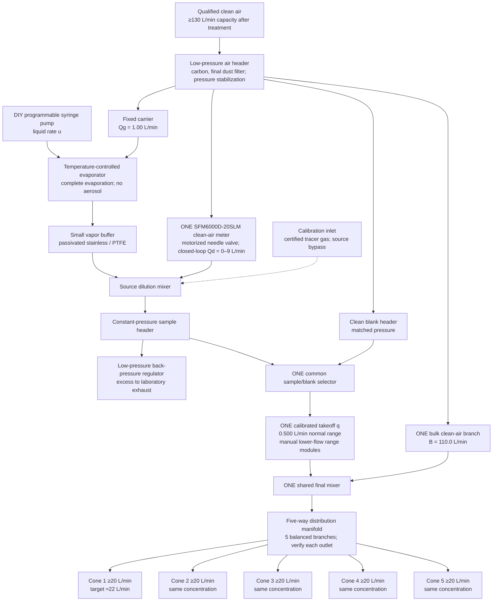
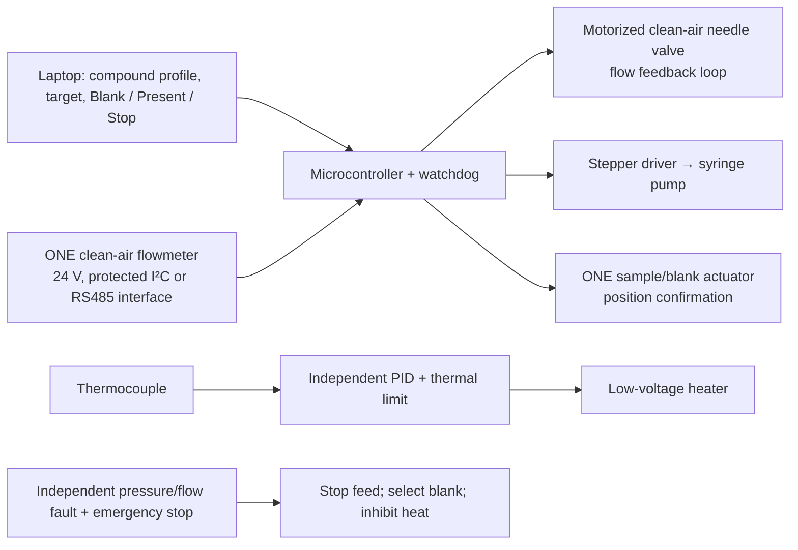

# Lower-cost five-output olfactometer — DIN performance targets

Revised 29 September 2026. Five people receive the **same concentration simultaneously**. This replaces the previous five-local-mixer design.

**Status: proposed engineering design, not demonstrated DIN EN 13725 compliance.** The full licensed 2022 text has not been available for clause-by-clause verification. The numbers supplied in the project brief are acceptance targets pending that check; a shopping list cannot establish conformity. [DIN Media identifies the current edition and its performance/quality-assurance sections](https://www.dinmedia.de/de/norm/din-en-13725/344441119).

## What makes it cheaper

Make the final mixture **once**, then divide it between five cones. Use one shared sample/blank valve and one sample takeoff, instead of five valves and five precision aliquot meters. Balance the five final branches mechanically and check them with a borrowed reference flowmeter.

Replace the $825 syringe pump with a calibrated open-source pump. Replace the $1,705 electronic controller with **one electronic clean-air flowmeter plus a motorized needle valve and feedback control**. Retain proper sample-contact materials, pressure control and verification. The reference architecture remains [Cain et al., Making Scents](https://pmc.ncbi.nlm.nih.gov/articles/PMC2805809/); this shared final mixer and lower flows are our proposed modifications, not a validated reproduction.

A reasonable **planning allowance is €1,000–1,800 in new parts if the school supplies suitable air, machining, a balance and calibration tools**. This is an engineering estimate, not a supplier quotation or a compliant-system price. New air treatment, specialty stainless syringes, passivation and external calibration can substantially increase it. No all-new DIN-compliant total has been established.

## Revised pneumatic flowchart

Use continuous generation and continuous clean-air flow. During concentration changes, present blank until the measured settling time has elapsed. The common selector switches all five assessors together; separate responses remain recorded individually.

### Flow and pressure specification

All stated flows use a common temperature/pressure reference. Convert standard litres from the electronic meter to actual outlet conditions. At the normal takeoff of 0.500 L/min, the shared final flow is 110.500 L/min, giving **22.100 L/min per outlet if balanced**. At very small takeoff, it approaches 22.000 L/min. Nominal equality does not prove each branch meets 20 L/min: measure every cone, including its least favorable operating condition.

Maximum clean-air demand is approximately 120.5 L/min: bulk 110 + source carrier 1 + dilution 9 + blank allowance 0.5. Specify ≥130 L/min after treatment and at the required pressure; include any continuous bypass or humidification consumption separately.

A low-pressure diaphragm pump is a candidate, not automatically qualified inhalation air. [HIBLOW's European HP-150 specification](https://hiblow-eu.com/products/pressure-pumps/) gives 150 L/min at 200 mbar, 50 Hz. Its permitted load and the pressure losses of the complete system must be checked. Filter carbon upstream of odor injection; carbon downstream removes the analyte. Check blank odor and air quality after the pump and treatment. Reuse a qualified existing school supply first.

Keep the sample header at stable pressure using a correctly sized **low-pressure** back-pressure regulator. The blank header must match it. The regulator must accept the entire 1–10 L/min source flow when disconnected, not just the usual excess. Do not substitute an ordinary safety-relief valve for a regulating valve. Place source restrictions, selector and final mixer close together to limit low-flow transit time.

## Continuous concentration control and gas-dilution range

The syringe controls introduced mass; the clean-air feedback loop controls additional gas attenuation. The meter is connected only to clean air, protecting it from novel compounds. A flowmeter does not actuate flow by itself: an external motorized valve is required.

For neat liquid:

`R [µg/min] = 1000 × density [g/mL] × syringe rate [µL/min]`

`C_final [mg/m³] = R / (Qg + Qv + Qd) × q / (110 + q)`

Here Qv is added vapor volume, q is the **single shared** sample takeoff, and all five ports receive C_final after complete mixing. The supplied calculator includes Qv using the ideal-gas approximation. Concentrations remain nominal until evaporation and recovery are verified for the molecule. A solution requires analyte concentration, solvent vapor volume and solvent-blank corrections; this calculator is for neat liquids.

At q = 0.500 L/min, density 0.90 g/mL, molecular weight 150 g/mol, and syringe rate 1.00 µL/min:

| Clean dilution Qd | Nominal concentration, every port |
|---:|---:|
| 0 L/min | ≈4.07 mg/m³ |
| 1 L/min | ≈2.04 mg/m³ |
| 4 L/min | ≈0.814 mg/m³ |
| 9 L/min | ≈0.407 mg/m³ |

These illustrate the arithmetic; they are not permitted exposure levels.

**The 0–9 L/min branch alone gives only about 10× attenuation.** A low syringe rate does not replace qualification of the gas dilution system. To provision the requested approximately 2^13 range without more electronic flowmeters, the proposal includes interchangeable, manually selected takeoff modules:

| Module | Proposed q at operating conditions | Approximate extra attenuation |
|---|---:|---:|
| A | 0.500 L/min | 1× |
| B | 0.050 L/min | 10× |
| C | 0.005 L/min | 100× |
| D | 0.0005 L/min | 1,000× |

Combining these with the electronic branch proposes approximately **9,955× concentration span at fixed syringe feed**, exceeding 8,192 in the ideal model. This is a proposed range-extension method, not measured capability. Use calibrated PTFE/FEP capillary restrictions or passivated stainless restrictions under controlled differential pressure. Select one module between test series, positively close unused connections, then perform leak and blank checks. Dimensions cannot be specified reliably without the available pressure and measured conductance. Qualify actual dilution at the nose, rather than calculating it from nominal capillary bore.

Module D is the difficult part: 0.5 mL/min requires a suitable borrowed low-flow reference, minimal downstream volume, long settling times where necessary, and tracer verification. A 1 mL volume alone has a two-minute residence time at this flow. If its recovery or stability fails, replace this module with a properly calibrated cascade stage; **do not claim the full range using syringe speed instead**. This range module is not ready for procurement until bench characterization establishes feasible restrictions and acceptable response.

Continuous adjustment is available for source setup. For standard-method threshold sessions, select a **qualified geometric concentration ladder**, provisionally factor 2, and lock out unqualified settings. Determine the applicable dilution-range definition, required minimum dilution, allowed step factor and assay protocol from the licensed 2022 edition. The proposed span does not establish those other conditions.

## Products and inexpensive substitutions

Product specifications and prices checked 29 September 2026 where accessible. Estimates below are budget allocations, not checked supplier prices. Order configurable parts only after confirming pressure, flow range, connection and wetted materials.

| Qty | Component / link | Budget or specification |
|---:|---|---|
| 1 | [Poseidon open-source syringe pump: files, electronics and assembly](https://github.com/pachterlab/poseidon) | Planning allowance €80–150 for a single DIY drive, excluding syringe, labor and delivery. Select suitable lead screw, motor, driver and small syringe. Calibrate delivery and short-term pulsation at actual operating rates. Printed parts are external supports only. |
| 1 | [New Era stainless syringes](https://mail.newerainstruments.com/products/syringe-pumps/syringes) | Candidate 1 mL syringe; supplier quote and seal-material confirmation. Obtain documented passivation for sample-contact stainless. Do not assume a low advertised pump rate is stable. Syringe friction may dominate pulsation. |
| 1 | [Sensirion SFM6000D-20SLM](https://sensirion.com/products/catalog/SFM6000D-20slm), [buy at DigiKey Germany](https://www.digikey.de/de/products/detail/sensirion-ag/SFM6000D-20SLM/17829359) | Listed €200.40 excluding VAT / €238.48 including German VAT. 24 V, I²C/RS485; typical accuracy 2% reading or 0.2% full scale. This is the distribution sensor, not the ≥100-piece OEM variant and not the SFC controller. Its typical accuracy is not a DIN certificate. |
| 1 | [SMC AS flow-control family](https://static.smc.eu/pdf/AS_EU.pdf) + external stepper coupling | Clean-air needle valve candidate, sized for 0–9 L/min at actual low differential pressure; use a grease-free throttle configuration and qualify neutral-air cleanliness. Planning allowance €40–100 for valve, actuator and coupling. Verify monotonic control, deadband and shutoff. Confirm operating pressure before selecting a part. |
| 1 | [BOLA miniature three-way stopcock family](https://www.bola.de/en/miniature-3-way-stopcocks-bola) | Choose an L-bore variant with confirmed PTFE/FEP wetted path and sufficient flow. External geared actuator, position feedback and mechanical return-to-blank are custom engineering. The manual stopcock itself is not electrically controlled. Budget €120–250 for the valve/actuation assembly; obtain quotation. A qualified fail-to-blank commercial selector is the fallback. |
| 1 + set | [Swagelok regulator family / sizing reference](https://www.swagelok.com/downloads/webcatalogs/en/ms-02-230.pdf) | Borrow/refurbish compatible regulators if available. The sample exhaust needs stable regulation near the selected low pressure over 0.0005–10 L/min load changes; a generic high-pressure regulator is not automatically suitable. Low-pressure sizing and a quote remain required. |
| 1 set | [BOLA tubing and components](https://www.bola.de/en/) | PTFE/FEP flow path, connections and range-module components. Five larger-bore final branches plus restrictions. Avoid unnecessary valves and sample-contact flowmeters. |
| 1 | [Arduino UNO Rev3](https://store.arduino.cc/products/arduino-uno-rev3) or school equivalent | Shared control for syringe drive, clean-air valve and common selector; properly interfaced 24 V flowmeter and motor drivers. Allow €60–120 for remaining electronics, supplies and enclosure, excluding heater. |
| 1 set | [Watlow heater selection reference](https://www.watlow.com/products/product-selector/heaters/product-pages/internal-solids/firerod-cartridge-heaters) | Small low-voltage heater, thermocouple, PID and independent thermal cutoff. Reuse appropriate school temperature control. Allow €100–200; dimensions/power depend on compound and evaporator geometry. |
| Custom | Passivated stainless evaporator/buffer, one source mixer, one final mixer/manifold, five cones | School workshop fabrication is the cost-saving assumption. Allow €250–500 for materials/fittings/finishing, but passivation and specialty parts may exceed this. Source buffer volumes need response/recovery testing, not blind enlargement. |
| Access | [HIBLOW HP-150 manufacturer specification](https://hiblow-eu.com/products/pressure-pumps/), suitable filtration and pressure gauges | Prefer a qualified existing supply. New pump, odor removal, dust filtration and any humidity conditioning are additional quoted items, excluded from the €1,000–1,800 reused-air allowance. |
| Borrow/service | Reference flow calibrators, balance, T/RH/CO₂ instruments, certified gas and analyzer | Avoid purchasing a GC–MS or tracer analyzer for annual checks. Arrange access through a partner laboratory or an external service; availability and costs are unconfirmed. |

The replacement pump drive plus electronic clean-air control is budgeted at roughly **€360–490 including the sensor's German VAT**, versus the original two devices alone at $2,530 before tax. Currency, labor, calibration and functionality differ, so this is not an exact percentage comparison. Cost reduction comes mainly from DIY motion/control and shared mixing; specialized materials and calibration remain real costs.

## Construction details that protect the measurement

**Evaporation:** meter liquid through a small capillary into a temperature-controlled flow-through evaporator. Provide 1 L/min carrier continuously. Use the lowest temperature demonstrated to evaporate the liquid completely without decomposition. Check the concentrated source against saturation at the coldest point and actual pressure before dilution. Do not nebulize it: airborne droplets undermine the intended gas concentration.

**Materials:** specify passivated 316L stainless and PTFE/FEP for sample-contact surfaces, including valves, restrictions, mixer and cones; document seals and fittings. Exclude glass from the proposed gas path until its eligibility under the 2022 text is settled. Use no silicone/rubber hoses or printed plastic in the sample path. General-purpose pneumatic parts and the electronic meter remain on clean-air branches. Final assembly, cleaning and passivation procedures need documentation. [Olfasense describes passivation and recovery/response type examination for EN 13725:2022](https://www.olfasense.com/pt-pt/2022/07/olfactometer-passivation-en13725/).

**Final mixing:** place the source takeoff into a mixing section with the full 110 L/min background, before the symmetric five-way manifold. Start with equal-length, equal-bore branches and external balancing valves/restrictions; calibrate each. Equal length alone is insufficient. Validate concentration uniformity at all five cones with tracer sampling. At about 22 L/min a 40 mm mouth has approximately 0.29 m/s mean velocity, but geometry alone does not establish the required velocity distribution or prevent entrainment during sniffing.

**Switching and clearing:** the common valve should provide continuous matched-flow blank/sample selection. Validate the clean blank, mixing delay and carryover after the complete shared final mixer and tubing. Locate it close to the mixer. Use a small final mixing volume that passes the homogeneity test; larger volume increases latency and contaminated surface area.

## Electrical control and simple use

The single flowmeter measures dilution air; it cannot prove five outlet flows. Use an independent header fault switch and check outlets with the borrowed calibrator before sessions. Actuator couplings, firmware, watchdog and hardware interlocks are still to be implemented and validated; the Python file is a calculator, not a live controller.

Operator sequence: choose compound and calibrated range module → establish clean air and temperature → command syringe speed and nominal concentration → remain on blank while stabilizing → present the same mixture at all five cones → record individual responses → blank before each change. Keep range selection manual to avoid another costly multiport valve. Present mode is inhibited if the actual flow is outside its qualified band, selector position is unknown or temperature/pressure is outside the validated conditions. A fault or loss of communications stops injection and returns to blank independently of a laptop command.

For a threshold series, keep syringe feed fixed where possible and vary calibrated gas attenuation. Changing feed is permitted during source-range setup, followed by stabilization and renewed concentration verification as needed. The supplied calculator solves dilution at a chosen pump speed; software may choose a qualified syringe speed/range when a requested target is otherwise unreachable.

## DIN acceptance record — must be completed, not assumed

Targets marked “brief” below come from the user's project requirements. Confirm the exact wording, formula, applicability and test procedure in DIN EN 13725:2022-06, especially sections 6, 7 and 10, before signing a conformity statement. Clause numbering from older editions must not be carried across unchecked.

| Item | Design response / evidence required | Current status |
|---|---|---|
| ≥20 L/min per port (brief) | Target ≈22; measure all five at actual presentation conditions, with uncertainty and worst-case operation | Designed; not measured |
| Dilution accuracy A_d <0.20; instability <5% (brief) | Certified tracer, suitable analyzer; qualify actual programmed settings and all range modules at every output | Tests required |
| At least annual tracer calibration; analyzer uncertainty <3% (brief) | Borrow or commission the appropriate analysis; keep certificates and settings record | Access and test plan required |
| Passivated sample-contact stainless (brief) | Materials/seals inventory, cleaning/passivation record, recovery and response checks | Procurement/fabrication requirement |
| n-butanol assessor thresholds 20–80 ppb (brief) | Screen and monitor each assessor under the standard's selection rules | Laboratory task |
| Laboratory repeatability r ≤0.477 (brief) | Reference-sample sessions and calculation using the prescribed method | Laboratory task; hardware cannot establish it |
| Room >21°C and RH 20–80% (brief) | Adopt 22–25°C with monitored RH within the required interval; qualify neutral air conditions separately | Room and air verification required |
| Port velocity ≥0.2 m/s (unverified brief) | 40 mm mouth gives ≈0.29 m/s mean; verify applicable definition and flow profile | Full-text check and test required |
| Range ≥2^13 and factor 1.4–2.4 (unverified brief) | Proposed ~9,955 span; provisional factor-2 ladder, including range transitions | Full-text check and range tests required |
| Room CO₂ ≤0.15%; glass eligibility (unverified brief) | Provide monitoring/ventilation provision; proposed gas path excludes glass | Full-text check required |
| Five simultaneous assessors / presentation method | Five outputs provide five simultaneous positions; this alone does not qualify panel selection, presentation timing, blanks, decision rules or reporting | Verify applicable yes/no protocol in licensed text |
| Novel-molecule absolute threshold | Demonstrate feed delivery, complete evaporation, no decomposition, recovery and settling for each compound | Compound-specific work required |

[Olfasense's calibration description](https://www.olfasense.com/fr/2023/01/olfactometer-calibrations/) describes annual individual-dilution checks with certified propane and an FID; [its services page](https://www.olfasense.com/odour-measurement-equipment/services/) offers calibration services. A borrowed/outside FID can address gas-dilution tests without owning a GC–MS. Propane dilution calibration does not establish recovery of every novel molecule.

The economical path to a defensible DIN claim is to build the shared architecture, verify the full text through school/university access, and use a partner laboratory for qualification and periodic checks. Until the acceptance record is complete, label results **nominal research thresholds**. Human exposure to a novel molecule additionally needs a compound-specific acceptable inhalation limit and the school's authorized testing procedure.

## Calculator examples

`python3 five_output_dilution.py --density 0.9 --mw 150 --syringe 1 --dilution 9`

`python3 five_output_dilution.py --density 0.9 --mw 150 --syringe 1 --sample-flow 0.005 --target 0.01`

Measured, qualified flow values replace nominal settings in the final report. The calculator does not authorize an exposure or establish standard compliance.
