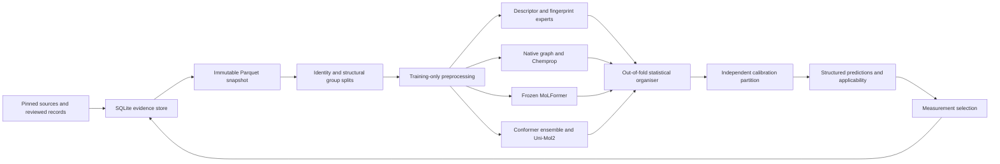

# Architecture and implemented scope

The implementation follows the canvas's sequence: structured molecular inputs, several experts, a statistical organiser and explicit confidence information. It makes the observation layer and evaluation splits explicit so that more complex components can be tested fairly.

## Evidence and identity

`schema.py` separates molecules, material/stimulus context, evidence and observations. Records preserve original values, units, medium, censoring, review status, original experiment identifiers and derived-versus-measured status. `store.py` enforces foreign keys and immutable record IDs, then writes content-addressed Parquet snapshots.

`chemistry.py` preserves isomeric SMILES and stereochemical uncertainty. Enantiomers remain distinct objects; their shared connectivity key keeps them in the same primary split group. Invalid or disconnected SMILES require explicit handling rather than silently becoming one pure compound. Isotope/stereo information remains in the structure and InChI identity; a specialised mixture resolver is not implemented.

`units.py` requires molecular weight, temperature and pressure for gas mass-to-molar conversion. Water and air remain separate tasks. The initial Abraham importer converts `log10(1 / ODT[ppmv])` to `log10(ODT[ppbv])` as `3 - value`.

`review.py` implements Europe PMC discovery, permitted full-text retrieval, basic JATS section/table/figure extraction, a review queue and a critical-field audit. Automatic acceptance requires at least 200 manually verified records **per enabled document class**, with at least 98% joint identity/value/unit/endpoint/medium agreement. This is stricter than a single pooled 200-record audit. No fabricated gold set is supplied; automatic patent/paper admission remains disabled.

## Experts

| Component | Implemented route | Execution status |
|---|---|---|
| RDKit descriptors | Train-only imputation/scaling, linear/logistic model | Trained for both basic endpoints |
| Morgan fingerprints | Chiral radius 2/3; linear, RF, XGBoost, nearest-neighbour controls | RF/XGBoost trained; other configurations available |
| Tanimoto GP | Optimised amplitude/noise, posterior prediction | Trained on thresholds |
| Native graph | Directed bond messages, non-backtracking updates, mean pooling, CIP/bond stereo, endpoint heads | Trained for both endpoints |
| Chemprop | Published package, fold-local D-MPNN training | Trained on thresholds |
| MoLFormer | Pinned published checkpoint, frozen pooled embedding, fitted linear/logistic head | Trained on thresholds |
| Uni-Mol2 | Pinned 84M checkpoint, fixed-seed optimised conformers, mean pooling, appended chiral fingerprints | Trained on thresholds |
| OpenPOM | Separate upstream adapter | Dependency unavailable locally; not a completed reproduction |

The native D-MPNN is explicitly a CALNEW implementation. It is not labelled as OpenPOM, POM or an exact Chemprop reproduction. The separate Chemprop adapter uses the published library.

Frozen encoders do not receive held-out sensory labels. Their known general-chemistry pretraining is recorded, although complete structure-level pretraining overlap cannot be inferred. The published MoLFormer checkpoint is the `both-10pct` checkpoint, not automatically the largest published training corpus.

Current pretrained adapters reject unsupported adaptation settings. Full fine-tuning, upper-layer tuning, LoRA and learned conformer attention are future implementations, not aliases for a frozen run.

## Training and organiser

The benchmark reserves approximately 70% of structural groups for development, 15% for calibration and 15% for final testing. Murcko groups handle ring systems; fingerprint clusters handle acyclic molecules. Sizes are balanced without consulting outcomes. Grouped random and all-fingerprint-cluster strategies are also available.

Within each outer development fold:

1. Inner folds select each expert's configuration using only outer-training molecules.
2. Inner held-out predictions fit the organiser.
3. Each expert is refitted on the outer training partition.
4. Expert and organiser scores are measured on the outer validation molecules.

This distinction matters: simply fitting a stacker to all out-of-fold predictions and reporting its error on those same predictions would still be an in-sample organiser evaluation.

Implemented organisers are equal-weight averaging, regularised endpoint-specific stacking, and a small per-target gating network. Inputs currently comprise expert predictions and missing-expert indicators. Adding uncertainty, domain similarity and protocol features to the learned gate is a later controlled extension.

Hyperparameter selection uses declared grids with a deterministic trial limit. `full.yaml` requests up to 50 initial configurations, five outer/three inner folds and five final seeds; candidates with fewer unique grid combinations run fewer trials. This is a reproducible bounded grid search, not a claim of a completed 50-trial Optuna campaign. Final seeds are averaged; outer model-selection scores currently use one seed per fold.

The simplest model in the declared order within one standard error of the best outer mean is selected. Bootstrap comparisons resample molecule connectivity groups. A failing/nonfinite candidate does not receive a score on a cherry-picked subset of predictions.

## Calibration and prediction

The selected model is calibrated using the reserved calibration partition. Classification uses a regularised temperature. Regression uses molecule-group conformal residual quantiles. The latter returns unbounded intervals when too few groups support the requested finite-sample quantile; it does not invent a narrow interval.

Prediction output distinguishes estimates, model disagreement, interval status, domain similarity and provenance. Participant and measurement variation remain explicitly unavailable when the trained artifact cannot estimate them. The interval's usual coverage assumptions do not become a guarantee for unfamiliar chemistry.

The prediction endpoint can report invalid input and unavailable heads per molecule. If a required selected expert fails, the system does not silently switch to a differently calibrated model. A validated fallback organiser with modality dropout would be a later experiment.

## Extension primitives already present

These are software components, not validated sensory model branches:

- `conformers.py`: ETKDGv3 seeds, force-field optimisation, RMS diversity filtering, explicit failures and geometry artifacts.
- `pharmacophore.py`: generic 2D pharmacophore fingerprints and training-membership checks for ligand similarity templates. Target-specific 3D pharmacophores are not yet implemented.
- `losses.py`: exact/left/right/interval-censored Gaussian likelihood, masked binary targets, separate pairwise likelihood and chance-corrected forced-choice detection.
- `hierarchical.py`: Student-t observation model over cross-fitted molecular predictions, overlap-gated study effects and an unknown-study variance term. This is not yet wired into the common benchmark or trained on resolved independent source data.
- `contextual.py`: fitted monotonic concentration curves with protocol/unit/range checks; participant spread summaries; a direct-plus-receptor cross-attention network over supplied embeddings. No LORAX reproduction or receptor dataset training is claimed.
- `active.py`: uncertainty/diversity/analogue/anchor allocation, random and diversity controls, protected prospective groups and explicit material eligibility.
- `panel.py`: response bounds and molecule-level pilot power simulation.

The original `olfactometer.py` now reports below-range and above-range responses as censored, identifies mixed repeats, and labels interior BET values as derived estimates. Its ppb documentation now correctly says nmol/mol. The software does not certify rig delivery, panel protocol compliance or material purity.

## Completion boundary

The basic models and research comparison pipeline are implemented and exercised. The complete architecture-selection research programme still needs wider source acquisition, resolved experiment lineage, neural adaptation/ablation studies, independent calibration assessment and new measurements. Those work items are explicit in [the improvement programme](IMPROVEMENTS.md).
